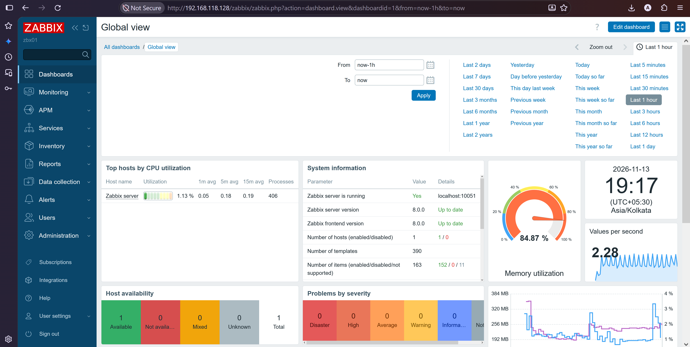

# Zabbix 8 on RHEL 10: Distributed Setup

A hands-on project that builds a Zabbix 8 monitoring platform on RHEL 10 with the **database on a separate server**. The Zabbix server and web frontend run on one server, and MySQL runs on its own minimal RHEL 10 server. Every step is documented with commands, expected output and verification checks.



## Architecture

```
   Administrator (browser)
            |
            | 80/tcp (HTTP)
            v
  +-----------------------------+            +-----------------------------+
  | zbx01                       |   3306/tcp | db01                        |
  | Zabbix server               | ---------> | MySQL 8.4                   |
  | Apache + PHP-FPM + frontend |            | database "zabbix"           |
  | Zabbix agent                |            | minimal RHEL 10 server      |
  | <zbx01-ip>                  |            | <db01-ip>                   |
  +-----------------------------+            +-----------------------------+
            ^
            | 10051/tcp (active agents)
            |
     Monitored hosts (Zabbix agent, 10050/tcp)
```

| Server | Role | Address |
|---|---|---|
| `db01` | MySQL database (minimal RHEL 10 server) | `<db01-ip>` |
| `zbx01` | Zabbix server and web frontend | `<zbx01-ip>` |

Use your own private or public IP addresses wherever `<db01-ip>` and `<zbx01-ip>` appear.

## Tools and Technologies

| Layer | Tool | Server | Purpose | Version check |
|---|---|---|---|---|
| Operating system | RHEL 10 | both | Base OS (`db01` is a minimal install) | `cat /etc/redhat-release` |
| Database | MySQL 8.4 | db01 | Stores all Zabbix data | `mysql --version` |
| Monitoring | Zabbix server 8.0 | zbx01 | Collects data, evaluates triggers | `zabbix_server -V` |
| Web server | Apache HTTP Server (httpd) | zbx01 | Serves the frontend | `httpd -v` |
| Application | PHP-FPM | zbx01 | Runs the frontend | `php-fpm -v` |
| Frontend | Zabbix web frontend | zbx01 | Dashboards and configuration | Shown in the page footer |
| Agent | Zabbix agent | all hosts | Monitors the hosts themselves | `zabbix_agentd -V` |
| Security | firewalld, SELinux (Enforcing) | all hosts | Network and access control | `getenforce` |
| Time | chrony | all hosts | Time synchronization | `chronyc tracking` |
| Workflow | VS Code, Git, GitHub | workstation | Documentation and version control | `git --version` |

## Documentation

Follow the documents in order.

| Phase | Document | Result | Status |
|---|---|---|---|
| Design | [Architecture](docs/00-architecture.md) | Components, ports and design decisions | Done |
| 0 | [Prerequisites](docs/01-prerequisites.md) | Static IP, hostname, time, firewall, SELinux | Done |
| 1 | [Database server](docs/02-database-install.md) | MySQL on `db01` with the `zabbix` database | Done |
| 2 | [Server and frontend](docs/03-server-frontend-install.md) | Zabbix 8 running on `zbx01` | In progress |
| 3 | [Add hosts and agent](docs/04-add-hosts-and-agent.md) | Monitored hosts reporting to Zabbix | Planned |
| Support | [Troubleshooting](docs/05-troubleshooting.md) | Symptoms, causes and fixes | Available |

## Network Ports

| From | To | Port | Purpose |
|---|---|---|---|
| Administrator | zbx01 | 80/tcp | Web frontend |
| zbx01 | db01 | 3306/tcp | Database access (allowed from `<zbx01-ip>` only) |
| Monitored hosts | zbx01 | 10051/tcp | Active agent data |
| zbx01 | Monitored hosts | 10050/tcp | Passive agent checks |

## Key Design Points

- **Separate database server:** isolates the data and lets each server be sized independently.
- **Least-privilege access:** the `zabbix` database user can connect only from the Zabbix server, and port 3306 accepts only that address.
- **Security controls stay on:** SELinux runs in Enforcing mode and firewalld is enabled on every server.
- **Static addressing:** fixed IPs and hostnames, so database and agent connections never break after a reboot.
- **Documented verification:** every phase ends with checks and expected results.

## Repository Structure

| Folder | Contents |
|---|---|
| `docs/` | Step-by-step guides (00 to 05) |
| `screenshots/` | Evidence images used in the guides. Add the PNG files with the names listed in `screenshots/README.md` and they appear in the guides automatically |

## Security Notes

- No real passwords or private configuration files are stored in this repository. Documents use placeholders such as `<DB_PASSWORD>`.
- Change the default Zabbix `Admin` password immediately after the first login.
- Screenshots are cleaned of passwords before publishing.

## Author

**Aakash Yadav**
GitHub: [aakashyadav-ak](https://github.com/aakashyadav-ak)
