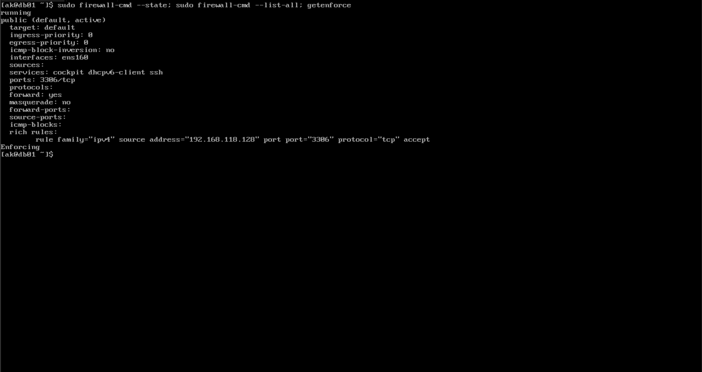

# RHEL 10: Server Prerequisites

Base configuration for the database server (`db01`). Repeat the same steps on `zbx01`, using its own hostname and IP address.

> **Placeholders:** Values in `<angle brackets>` depend on your environment. Replace them before running a command. In a lab (for example a VMware NAT network) use the VM's private IP. In a real environment use the static private or public IP that fits your requirement.

## 1. Set the hostname

```bash
sudo hostnamectl set-hostname db01
```

## 2. Configure a static IP

Replace the connection name, IP and gateway with your own network details. Find them with `nmcli device status` and `ip route`.

```bash
sudo nmcli connection modify "ens160" \
  ipv4.method manual \
  ipv4.addresses <db01-ip>/24 \
  ipv4.gateway <gateway-ip> \
  ipv4.dns "8.8.8.8 1.1.1.1"
```

Apply it as a separate command:

```bash
sudo nmcli connection up "ens160"
```

## 3. Configure host resolution (optional)

Skip this step if you connect between the servers with IP addresses only, as the rest of this project does. To use names instead, add both servers to `/etc/hosts`. Use private IPs, not public internet IPs, and add these lines only once.

```bash
echo "<db01-ip>   db01"  | sudo tee -a /etc/hosts
echo "<zbx01-ip>  zbx01" | sudo tee -a /etc/hosts
```

## 4. Update the system and install utilities

```bash
sudo dnf update -y
sudo dnf install -y curl
```

## 5. Configure time synchronization

```bash
sudo timedatectl set-timezone Asia/Kolkata
sudo systemctl enable --now chronyd
```

## 6. Enable the firewall and check SELinux

```bash
sudo systemctl enable --now firewalld
sudo firewall-cmd --state
getenforce
```

Keep SELinux in **Enforcing** mode.



*firewalld running and SELinux in Enforcing mode*

## 7. Verify the configuration

```bash
hostname
ip a
ip route
ping -c 2 <peer-ip>
timedatectl
getenforce
```

Expected results:

| Check | Expected |
|---|---|
| `hostname` | `db01` |
| `ip a` | Your static IP on the interface |
| `ip route` | `default via <gateway-ip>` |
| `ping -c 2 <peer-ip>` | `0% packet loss` (`<peer-ip>` is the IP of the other server) |
| `timedatectl` | Time zone `Asia/Kolkata`, clock synchronized |
| `getenforce` | `Enforcing` |


*Ping between the two servers*
