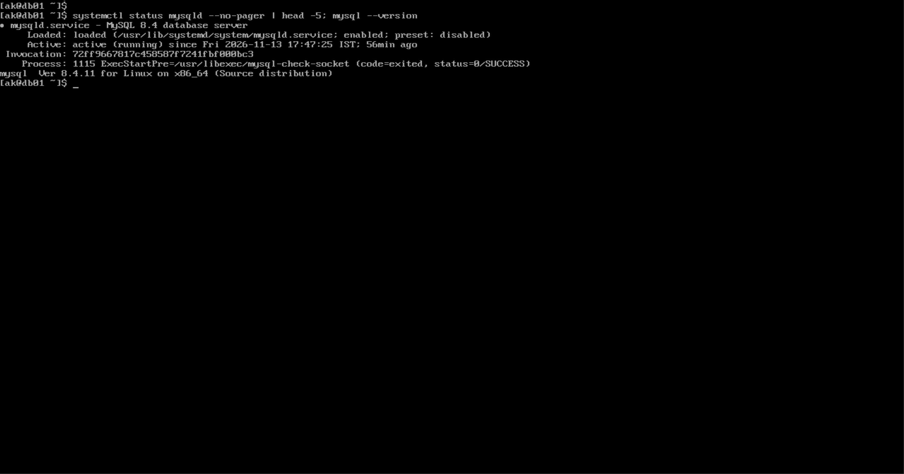
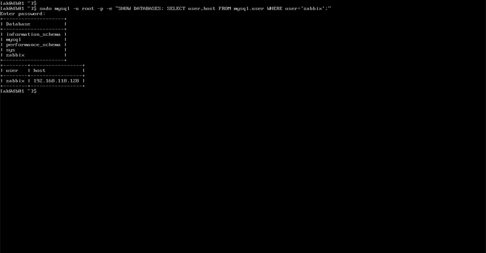
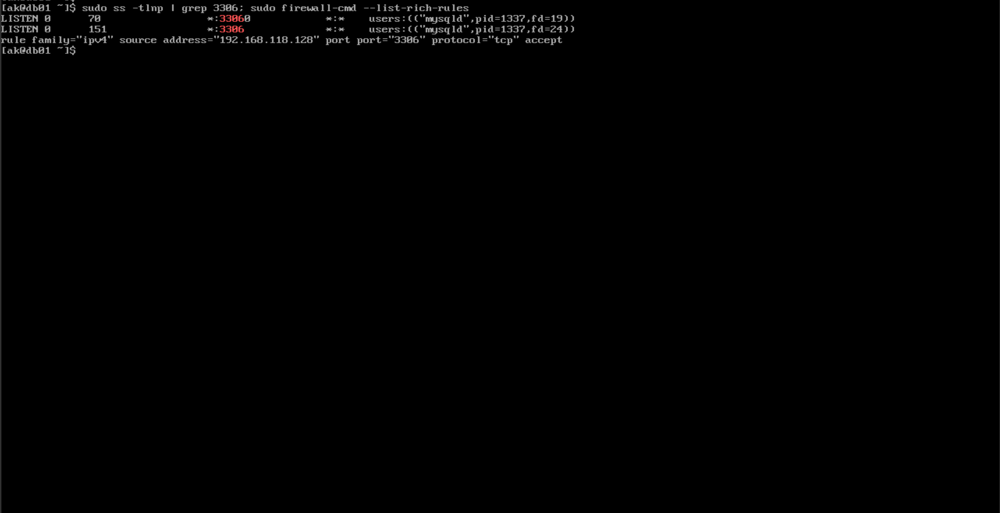
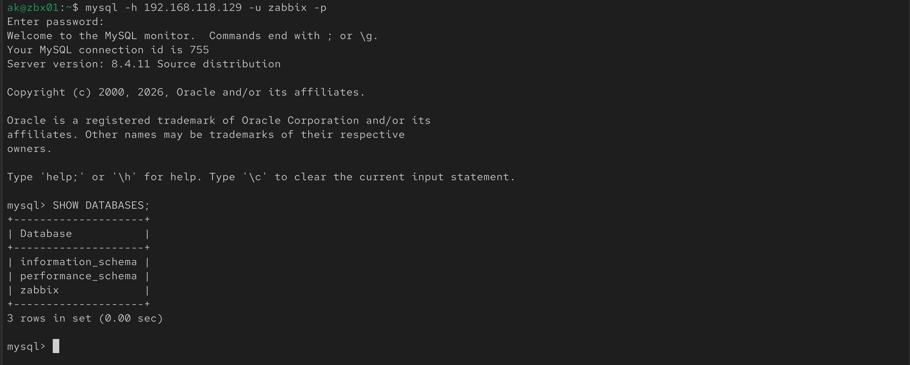

# MySQL Database Server (db01)

Installs and prepares MySQL 8.4 on `db01` for Zabbix. Complete [01-prerequisites.md](01-prerequisites.md) first.

> **Placeholders:** Replace values in `<angle brackets>` with your own. Use `<DB_PASSWORD>` for a strong password of your choice, and never store the real password in this repository.

| Placeholder | Meaning |
|---|---|
| `<db01-ip>` | Private IP of the database server |
| `<zbx01-ip>` | Private IP of the Zabbix server (the only host allowed to connect) |
| `<DB_PASSWORD>` | Password of the `zabbix` database user |

## 1. Install and start MySQL (db01)

```bash
sudo dnf install -y mysql8.4-server
sudo systemctl enable --now mysqld
systemctl status mysqld --no-pager
mysql --version
```

Expected: `Active: active (running)` and `mysql  Ver 8.4.x`. Do not install MariaDB on the same server.



*MySQL service active and version check*

## 2. Secure the installation (db01)

```bash
sudo mysql_secure_installation
```

| Question | Answer |
|---|---|
| Password for user root | Press **Enter** (none set yet) |
| VALIDATE PASSWORD component | `n` (lab) or `y` (production) |
| Set the root password | Enter a strong password twice |
| Remove anonymous users | `y` |
| Disallow root login remotely | `y` |
| Remove test database | `y` |
| Reload privilege tables | `y` |

## 3. Create the Zabbix database and user (db01)

```bash
sudo mysql -u root -p
```

```sql
CREATE DATABASE zabbix CHARACTER SET utf8mb4 COLLATE utf8mb4_bin;
CREATE USER 'zabbix'@'<zbx01-ip>' IDENTIFIED BY '<DB_PASSWORD>';
GRANT ALL PRIVILEGES ON zabbix.* TO 'zabbix'@'<zbx01-ip>';
SET GLOBAL log_bin_trust_function_creators = 1;
EXIT;
```

| Statement | Purpose |
|---|---|
| `CREATE DATABASE` | Creates the database with the character set Zabbix requires |
| `CREATE USER` | Creates a user that can log in **only from the Zabbix server** |
| `GRANT` | Gives the user rights on the `zabbix` database only |
| `SET GLOBAL` | Needed only while the Zabbix tables are imported; it resets when MySQL restarts. A warning about this setting is normal. Set it back to `0` after the import. |

Verify:

```bash
sudo mysql -u root -p -e "SHOW DATABASES; SELECT user,host FROM mysql.user WHERE user='zabbix';"
```

Expected: the `zabbix` database, and the user `zabbix` with host `<zbx01-ip>`.



*The `zabbix` database and the user allowed only from the Zabbix server*

## 4. Allow network connections (db01)

```bash
sudo ss -tlnp | grep 3306
```

Expected: `*:3306`. If it shows `127.0.0.1:3306` or nothing, edit `/etc/my.cnf.d/mysql-server.cnf` and add these lines under `[mysqld]`:

```
bind-address=0.0.0.0
skip-networking=0
```

Then restart the service:

```bash
sudo systemctl restart mysqld
```

## 5. Open port 3306 for the Zabbix server only (db01)

```bash
sudo firewall-cmd --permanent --add-rich-rule='rule family="ipv4" source address="<zbx01-ip>" port protocol="tcp" port="3306" accept'
sudo firewall-cmd --reload
sudo firewall-cmd --list-rich-rules
```

Expected:

```
rule family="ipv4" source address="<zbx01-ip>" port port="3306" protocol="tcp" accept
```

SELinux needs no change, because 3306 is the default MySQL port. Keep it in Enforcing mode.



*MySQL listening on 3306 and the firewall rule for the Zabbix server only*

## 6. Test the remote login (zbx01)

On RHEL 10 the MySQL client package is `mysql8.4`.

```bash
sudo dnf install -y mysql8.4
mysql -h <db01-ip> -u zabbix -p
```

```sql
SHOW DATABASES;
```

Expected: the list includes `zabbix`.

| Error | Cause |
|---|---|
| `ERROR 2003 Can't connect` | MySQL is not listening on the network (step 4) or the firewall rule is missing (step 5) |
| `ERROR 1045 Access denied` | Wrong password, or `<zbx01-ip>` in `CREATE USER` is not the real IP of the Zabbix server |



*Successful login from zbx01 and `SHOW DATABASES`*

## 7. Verification checklist

| Check | Command | Expected |
|---|---|---|
| Service running | `systemctl is-active mysqld` | `active` |
| Listening on the network | `sudo ss -tlnp \| grep 3306` | `*:3306` |
| Firewall rule | `sudo firewall-cmd --list-rich-rules` | Rule for `<zbx01-ip>` |
| SELinux | `getenforce` | `Enforcing` |
| Remote login | `mysql -h <db01-ip> -u zabbix -p` (from zbx01) | `zabbix` database visible |

Next: Zabbix server and frontend (`03-server-frontend-install.md`).
