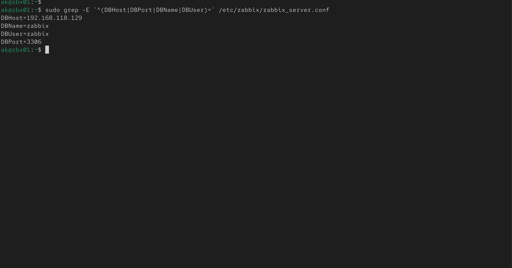
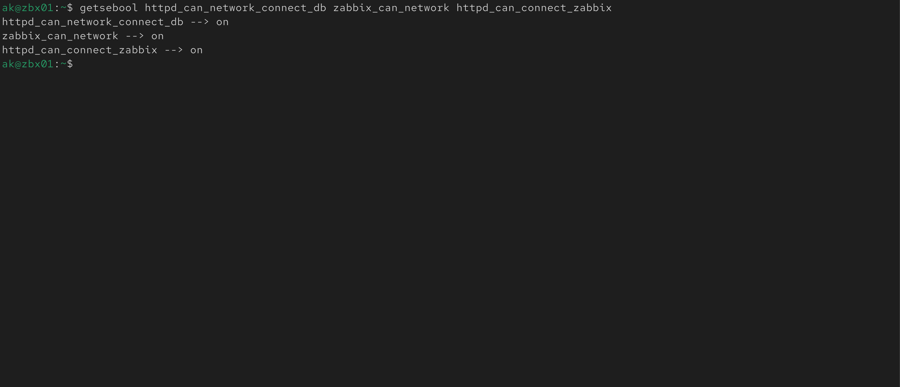
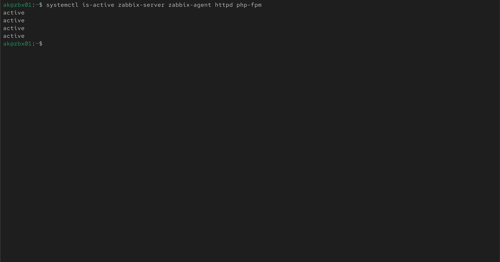
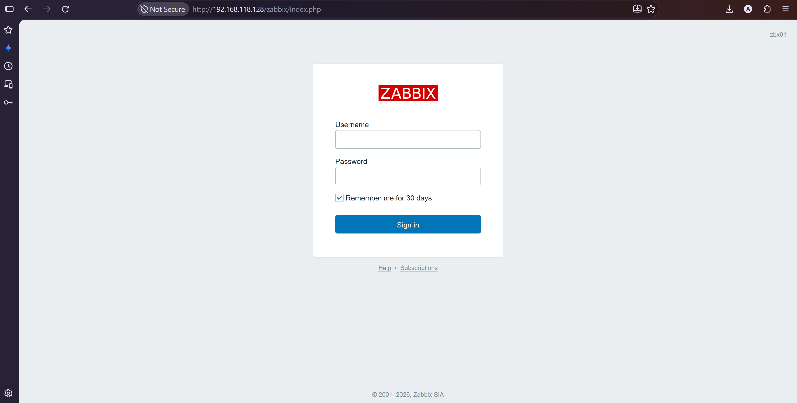
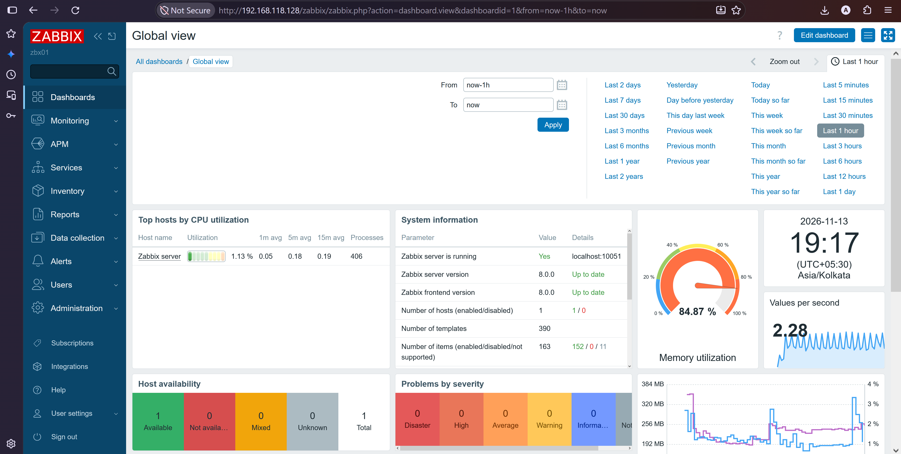

# Zabbix 8 Server and Frontend (zbx01)

Installs the Zabbix server, the Apache web frontend and the Zabbix agent on `zbx01`, using the MySQL database on `db01`. Complete [01-prerequisites.md](01-prerequisites.md) and [02-database-install.md](02-database-install.md) first.

> **Placeholders:** Replace values in `<angle brackets>` with your own. Never store the real password in this repository.

| Placeholder | Meaning |
|---|---|
| `<db01-ip>` | Private IP of the database server |
| `<zbx01-ip>` | Private IP of the Zabbix server |
| `<DB_PASSWORD>` | Password of the `zabbix` database user |

> **Check against the official generator.** Package names and repository URLs can change between releases. On zabbix.com/download select **Zabbix 8.0, RHEL 10, Server + Frontend + Agent, MySQL, Apache** and compare the commands with this page.

## 1. Add the Zabbix repository (zbx01)

```bash
sudo rpm -Uvh https://repo.zabbix.com/zabbix/8.0/release/rhel/10/noarch/zabbix-release-latest.el10.noarch.rpm
sudo dnf clean all
```

If the EPEL repository is enabled, it must not provide Zabbix packages. Edit `/etc/yum.repos.d/epel.repo` and add this line under the `[epel]` section:

```
excludepkgs=zabbix*
```

## 2. Install the packages (zbx01)

```bash
sudo dnf install -y zabbix-server-mysql zabbix-web-mysql zabbix-apache-conf zabbix-sql-scripts zabbix-selinux-policy zabbix-agent
```

| Package | Purpose |
|---|---|
| `zabbix-server-mysql` | Zabbix server with MySQL support |
| `zabbix-web-mysql` | Web frontend (PHP) with MySQL support |
| `zabbix-apache-conf` | Apache configuration for the frontend |
| `zabbix-sql-scripts` | Database schema files |
| `zabbix-selinux-policy` | SELinux policy for Zabbix |
| `zabbix-agent` | Agent that monitors the Zabbix server itself |

## 3. Import the database schema (zbx01 to db01)

Find the schema file. The path can differ between Zabbix versions:

```bash
rpm -ql zabbix-sql-scripts | grep mysql/server
```

```
/usr/share/zabbix/sql-scripts/mysql/server.sql.gz
```

Import it into the remote database. Use the path shown above:

```bash
zcat /usr/share/zabbix/sql-scripts/mysql/server.sql.gz | mysql --default-character-set=utf8mb4 -h <db01-ip> -u zabbix -p zabbix
```

Enter `<DB_PASSWORD>`. There is no output on success, and the import takes one to two minutes. Verify:

```bash
mysql -h <db01-ip> -u zabbix -p zabbix -e "SHOW TABLES;" | head
```

Expected: a list of tables such as `hosts`, `items` and `users`.

## 4. Turn off the temporary setting (db01)

On `db01`, set the option back after the import:

```bash
sudo mysql -u root -p -e "SET GLOBAL log_bin_trust_function_creators = 0;"
```

## 5. Configure the Zabbix server (zbx01)

```bash
sudo vi /etc/zabbix/zabbix_server.conf
```

Find these five parameters (press `/` and type the name to search). Remove the `#` at the start of the line if it is there, and set the values:

```
DBHost=<db01-ip>
DBPort=3306
DBName=zabbix
DBUser=zabbix
DBPassword=<DB_PASSWORD>
```

Verify that only your values are active:

```bash
sudo grep -E '^(DBHost|DBPort|DBName|DBUser)=' /etc/zabbix/zabbix_server.conf
```

```
DBHost=<db01-ip>
DBPort=3306
DBName=zabbix
DBUser=zabbix
```



*Database settings in `zabbix_server.conf` (password not shown)*

## 6. SELinux settings (zbx01)

SELinux stays in Enforcing mode. Allow the database connection and the frontend-to-server connection:

```bash
sudo setsebool -P httpd_can_network_connect_db on
sudo setsebool -P zabbix_can_network on
sudo setsebool -P httpd_can_connect_zabbix on
getsebool httpd_can_network_connect_db zabbix_can_network httpd_can_connect_zabbix
```

```
httpd_can_network_connect_db --> on
zabbix_can_network --> on
httpd_can_connect_zabbix --> on
```



*SELinux booleans enabled for Zabbix*

## 7. Open the web port (zbx01)

```bash
sudo firewall-cmd --permanent --add-service=http
sudo firewall-cmd --reload
sudo firewall-cmd --list-services
```

Expected: `http` and `ssh` in the list. Port 10051 for remote agents is opened in the next phase.

## 8. Start the services (zbx01)

```bash
sudo systemctl enable --now zabbix-server zabbix-agent httpd php-fpm
systemctl is-active zabbix-server zabbix-agent httpd php-fpm
```

```
active
active
active
active
```

Check the server log for database errors:

```bash
sudo tail -n 20 /var/log/zabbix/zabbix_server.log
```

Expected: the server starts its processes, with no `cannot connect to the database` message.



*Zabbix server, agent, Apache and PHP-FPM running*

## 9. Complete the web setup

Open a browser on your workstation:

```
http://<zbx01-ip>/zabbix
```

| Wizard step | What to enter |
|---|---|
| Welcome | Choose your language |
| Check of pre-requisites | All items must show OK |
| Configure DB connection | Type `MySQL`, host `<db01-ip>`, port `3306`, name `zabbix`, user `zabbix`, password `<DB_PASSWORD>` |
| Settings | Server name `zbx01`, choose your time zone |
| Pre-installation summary | Check the values, then continue |
| Install | Wait for the success message |

Leave database TLS encryption off in a lab. Enable it in production.

Log in with the default account **Admin** and password **zabbix**, then change the password immediately in the user profile.



*Zabbix frontend login page*

## 10. Verification checklist

| Check | Command or place | Expected |
|---|---|---|
| Services running | `systemctl is-active zabbix-server httpd` | `active` |
| Server log | `/var/log/zabbix/zabbix_server.log` | No database errors |
| SELinux | `getenforce` | `Enforcing` |
| Frontend opens | `http://<zbx01-ip>/zabbix` | Login page |
| Server status | Dashboard, System information | Zabbix server is running: Yes |
| Own host | Monitoring, Hosts | `Zabbix server` host with agent available |



*Zabbix dashboard after the first login*

Next: add hosts and agent (`04-add-hosts-and-agent.md`).
