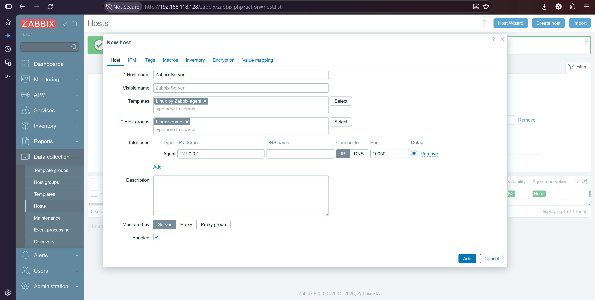
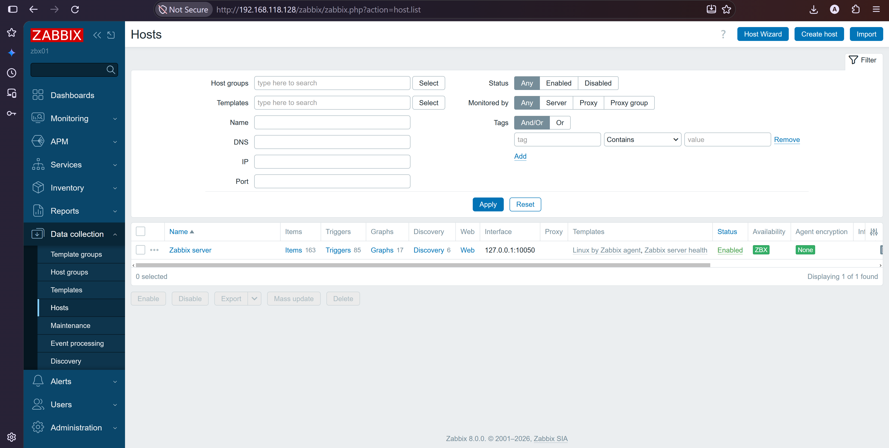
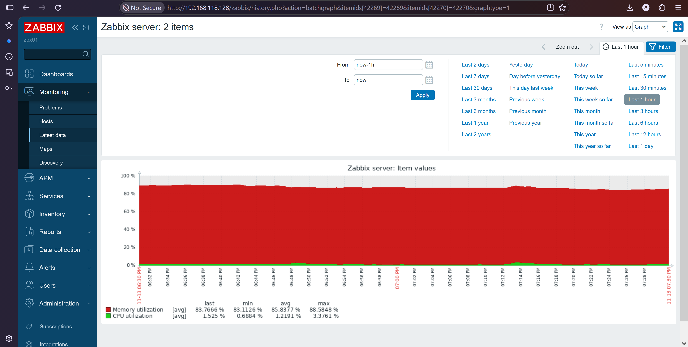
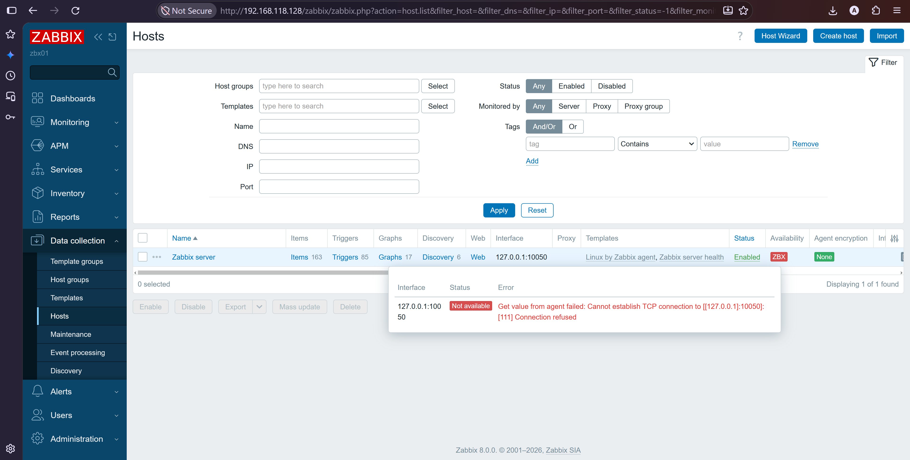

# Adding Hosts and the Zabbix Agent

Installs the Zabbix agent on a monitored server and adds it to the Zabbix frontend. This example monitors `db01`. The same steps work for any RHEL server. Complete [03-server-frontend-install.md](03-server-frontend-install.md) first.

> **Placeholders:** Replace values in `<angle brackets>` with your own. Use private IPs.

| Placeholder | Meaning |
|---|---|
| `<zbx01-ip>` | Private IP of the Zabbix server |
| `<db01-ip>` | Private IP of the host you want to monitor |

## 1. How the agent talks to the server

| Mode | Direction | Port | Config parameter |
|---|---|---|---|
| Passive | Server asks the agent | 10050/tcp on the monitored host | `Server=` |
| Active | Agent sends data to the server | 10051/tcp on the Zabbix server | `ServerActive=` |

This guide sets up both, which is the common setup in production.

## 2. Install the agent (db01)

```bash
sudo rpm -Uvh https://repo.zabbix.com/zabbix/8.0/release/rhel/10/noarch/zabbix-release-latest.el10.noarch.rpm
sudo dnf clean all
sudo dnf install -y zabbix-agent
```

If EPEL is enabled on this host, add `excludepkgs=zabbix*` under `[epel]` in `/etc/yum.repos.d/epel.repo`.

## 3. Configure the agent (db01)

```bash
sudo vi /etc/zabbix/zabbix_agentd.conf
```

Find these three parameters (press `/` and type the name to search), remove the `#` if present, and set:

```
Server=<zbx01-ip>
ServerActive=<zbx01-ip>
Hostname=db01
```

`Hostname` must match the host name you enter in the frontend exactly, including upper and lower case. Verify:

```bash
sudo grep -E '^(Server|ServerActive|Hostname)=' /etc/zabbix/zabbix_agentd.conf
```

```
Server=<zbx01-ip>
ServerActive=<zbx01-ip>
Hostname=db01
```

## 4. Open the firewall

On **db01**, allow the Zabbix server to reach the agent:

```bash
sudo firewall-cmd --permanent --add-rich-rule='rule family="ipv4" source address="<zbx01-ip>" port protocol="tcp" port="10050" accept'
sudo firewall-cmd --reload
```

On **zbx01**, allow the agent to send active data:

```bash
sudo firewall-cmd --permanent --add-rich-rule='rule family="ipv4" source address="<db01-ip>" port protocol="tcp" port="10051" accept'
sudo firewall-cmd --reload
```

Check with `sudo firewall-cmd --list-rich-rules` on each server.

## 5. Start the agent (db01)

```bash
sudo systemctl enable --now zabbix-agent
systemctl is-active zabbix-agent
sudo ss -tlnp | grep 10050
```

```
active
LISTEN 0  128  0.0.0.0:10050  0.0.0.0:*  users:(("zabbix_agentd",...))
```


*Zabbix agent active and listening on port 10050*

## 6. Test the connection from zbx01

```bash
sudo dnf install -y zabbix-get
zabbix_get -s <db01-ip> -k agent.ping
zabbix_get -s <db01-ip> -k system.hostname
```

```
1
db01
```

`1` means the agent answers the server. If `zabbix-get` is not available, test the port only:

```bash
timeout 3 bash -c '</dev/tcp/<db01-ip>/10050' && echo "port 10050 open"
```

## 7. Add the host in the frontend

Open `http://<zbx01-ip>/zabbix` and go to **Data collection, Hosts, Create host**. Menu names can differ slightly between versions.

| Field | Value |
|---|---|
| Host name | `db01` (same as `Hostname=` in the agent config) |
| Templates | `Linux by Zabbix agent` |
| Host groups | `Linux servers` |
| Interfaces | Add, Agent, IP address `<db01-ip>`, port `10050` |

Click **Add**.



*Host form with the Linux template and agent interface*

## 8. Verify

Wait one to two minutes, then check:

| Check | Where | Expected |
|---|---|---|
| Agent availability | Data collection, Hosts | Green **ZBX** icon for `db01` |
| Data arriving | Monitoring, Latest data, host `db01` | CPU, memory and disk items with values |
| Server host | Monitoring, Hosts | `Zabbix server` host also available |



*Green ZBX icon: the agent is available*



*Latest data collected from db01*

## 9. Optional: trigger a test problem

Stop the agent to see an alert, then start it again:

```bash
sudo systemctl stop zabbix-agent
```

After a few minutes, **Monitoring, Problems** shows that the Zabbix agent on `db01` is not available. Then:

```bash
sudo systemctl start zabbix-agent
```

The problem closes after the next successful check.



*Problem raised after stopping the agent*

## 10. Adding more hosts

Repeat steps 2 to 7 for each server: install the agent, set `Server`, `ServerActive` and a unique `Hostname`, open the two firewall rules, and create the host in the frontend. Use a name for `Hostname` that is unique across your environment.

Next: [Troubleshooting](05-troubleshooting.md).
